<!-- ═══════════════════════════════════════════════════════════════════════
     Sahil Munj · GitHub Profile README
     Repo: github.com/sahilmunj10/sahilmunj10
     Assets live in ./assets — keep paths relative so forks still render.
     ═══════════════════════════════════════════════════════════════════════ -->

<!-- Hero banner (custom animated SVG, local asset) -->

  

<!-- Typing animation (external service; text below keeps the hero readable if it fails) -->

  

  <em>I build practical software and explore intelligent systems — from healthcare platforms and gamified learning tools to gesture-controlled games and data dashboards.</em>

<!-- Section navigation -->

  &nbsp;
  &nbsp;
  &nbsp;
  

<!-- Primary links -->

  
  
  

## About Me

<table>
  <tr>
    <td width="55%" valign="top">
      
I'm a <strong>Computer Engineering student</strong> who learns by shipping. Most of my time goes into building full-stack web applications — React/TypeScript on the front, Node.js and Express on the back — and wiring them to real data stores like MongoDB, SQLite (via Prisma) and Firebase.

      
I'm increasingly drawn to <strong>AI-powered applications and data-driven systems</strong>: integrating LLM APIs into products, real-time computer vision in the browser, rule-based decision engines, and turning raw datasets into interactive dashboards.

      
I prefer projects that solve a concrete problem — placement workflows for a college, care continuity for rural patients, a more engaging way to learn to code — and I use each one to pick up a new technology hands-on.

      

        
        
      

    </td>
    <td width="45%" valign="top" align="center">
      
    </td>
  </tr>
</table>

## Featured Projects

Seven projects spanning healthcare technology, education, AI, computer vision, data analytics and web applications. Every description is based on the repository source.

<table>
<tr>
<td width="50%" valign="top">
<h3 align="center">🩺 SwastyaSetu</h3>

 

Care-continuity platform for rural public health in India, linking patients, ASHA workers, PHC doctors, labs, pharmacies and district officers through seven role-based dashboards. Built as a Smart India Hackathon prototype.

<b>Highlight:</b> guided triage engine, 8-stage referral tracking, offline-first PWA sync and English/Marathi/Hindi localisation, on a Prisma/SQLite backend with JWT auth.

<b>Stack:</b> React 18 · TypeScript · Vite · Tailwind · Express · Prisma · SQLite · Leaflet · Recharts

</td>
<td width="50%" valign="top">
<h3 align="center">🎮 CodeQuest</h3>

 

Full-stack gamified coding platform: structured courses, in-browser coding challenges, project tutorials, community feed and real-time chat, driven by XP, levels, streaks, badges and a leaderboard.

<b>Highlight:</b> Monaco editor with JavaScript/Python/HTML execution, a Groq-powered AI assistant and Socket.IO chat rooms over 15 Mongoose models.

<b>Stack:</b> React 19 · Vite 7 · Tailwind v4 · Node.js · Express · MongoDB · Socket.IO · Groq API

</td>
</tr>
<tr>
<td width="50%" valign="top">
<h3 align="center">🔬 ResearchIQ</h3>

Research-oriented project focused on making academic research workflows faster and more intelligent.

<b>Status:</b> repository is currently private. A detailed description, features and tech stack will be added once it is public.

</td>
<td width="50%" valign="top">
<h3 align="center">✋ Hand Gesture Game</h3>

 

<i>Catch the Stars</i> — a webcam-controlled arcade game: steer a basket with your hand, catch stars and coins, dodge bombs. All tracking runs client-side; no video leaves the device.

<b>Highlight:</b> rule-based gesture classifier (palm, thumbs-up, peace, fist) on MediaPipe landmarks triggers power-ups; procedural Web Audio sound; mouse/touch fallback.

<b>Stack:</b> JavaScript · MediaPipe Hands · HTML5 Canvas · Web Audio API · Vite

 

</td>
</tr>
<tr>
<td width="50%" valign="top">
<h3 align="center">📊 Retail Sales Analysis Dashboard</h3>

Interactive Power BI report on the Superstore retail dataset, turning raw order records into an executive view of sales, profit, orders and product performance.

<b>Highlight:</b> KPIs for Total Sales, Profit, Orders, Average Sales and Profit Margin %, monthly trend, category/region breakdowns, Top-10 products and slicer filtering; ships a reusable <code>.pbit</code> template.

<b>Stack:</b> Power BI · DAX · Power Query

</td>
<td width="50%" valign="top">
<h3 align="center">🎓 E-Placement Portal</h3>

 

College placement portal with separate student and faculty workflows: post placements with deadlines, apply, track applications and manage students.

<b>Highlight:</b> in-browser resume generator with PDF download, auto-expiring placements, dark mode, and email notifications via Firebase Cloud Functions + Nodemailer.

<b>Stack:</b> HTML · Tailwind · JavaScript · Firebase (Auth, Firestore, Storage, Functions)

 

</td>
</tr>
<tr>
<td colspan="2" valign="top">
<h3 align="center">🍽️ Foodora</h3>

 

Responsive restaurant web app covering the full dining flow: browse and search the menu, build a cart with a live bill, place an order and book a table.

<b>Highlight:</b> email OTP login via Google Apps Script, and every order and booking pushed to the restaurant on Telegram — a working pipeline with no backend server.

<b>Stack:</b> HTML · CSS · JavaScript · Google Apps Script · Telegram Bot API · Vercel

 

</td>
</tr>
</table>

More on my profile: a real-time <a href="https://github.com/sahilmunj10/chatapp">chat app</a> (Socket.IO), a <a href="https://github.com/sahilmunj10/Python-Analysis-Page">Python analysis page</a> (Streamlit) and <a href="https://github.com/sahilmunj10/X-GEO">X-GEO</a>, an explainable GEO optimisation tool.

## Tech Stack

Only technologies that appear in my public repositories.

<table align="center">
  <tr>
    <td align="right"><strong>Languages</strong></td>
    <td></td>
  </tr>
  <tr>
    <td align="right"><strong>Frontend</strong></td>
    <td></td>
  </tr>
  <tr>
    <td align="right"><strong>Backend</strong></td>
    <td>&nbsp;</td>
  </tr>
  <tr>
    <td align="right"><strong>Databases</strong></td>
    <td>&nbsp;</td>
  </tr>
  <tr>
    <td align="right"><strong>AI · ML · Data</strong></td>
    <td>
      
      
      
      
      
      
    </td>
  </tr>
  <tr>
    <td align="right"><strong>Tools &amp; Platforms</strong></td>
    <td>&nbsp;</td>
  </tr>
</table>

## What I Like Building

<table>
  <tr>
    <td width="25%" valign="top" align="center">
      <h4>Practical software</h4>
      Applications with a clear user and a job to do — placement portals, restaurant ordering, chat.  <em>E-Placement · Foodora</em>
    </td>
    <td width="25%" valign="top" align="center">
      <h4>AI-enabled &amp; research systems</h4>
      Products where an LLM, a decision engine or a model adds real leverage.  <em>CodeQuest · SwastyaSetu · ResearchIQ</em>
    </td>
    <td width="25%" valign="top" align="center">
      <h4>Interactive experiences</h4>
      Real-time, playful interfaces — computer vision input, gamified progression, live chat.  <em>Hand Gesture Game · CodeQuest</em>
    </td>
    <td width="25%" valign="top" align="center">
      <h4>Data-driven problem solving</h4>
      Turning raw data into KPIs, trends and decisions people can act on.  <em>Retail Sales Dashboard · Python Analysis Page</em>
    </td>
  </tr>
</table>

## GitHub Activity

Statistics reflect public repositories only.

  
  

  

<!-- Contribution snake — generated by .github/workflows/snake.yml into the `output` branch -->
<picture>
  <source media="(prefers-color-scheme: dark)" srcset="https://raw.githubusercontent.com/sahilmunj10/sahilmunj10/output/github-snake-dark.svg" />
  <source media="(prefers-color-scheme: light)" srcset="https://raw.githubusercontent.com/sahilmunj10/sahilmunj10/output/github-snake.svg" />
  
</picture>

## Connect

  &nbsp;
  &nbsp;
  

  Open to internships, collaborations and conversations about software, AI and data. 
  If one of the projects above is useful to you, a ⭐ on the repo is always appreciated.

